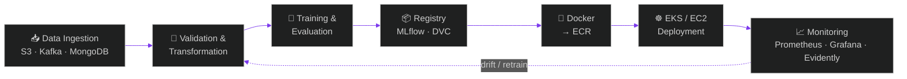

<!-- ============================================================
  GitHub Profile README — Mohammed Asif Ameen Baig  (dark theme)
  Place this file in a PUBLIC repo named exactly: asif684
  Palette: #0d1117 (bg) · #21262d (card) · #00d4ff (cyan) · #7c3aed (violet) · #1f6feb (blue)
============================================================ -->

<div align="center">


<a href="https://github.com/asif684">
  
</a>

<a href="https://www.linkedin.com/in/mohammedasifameenbaig/"></a>
<a href="mailto:md.asif.ameen.baig.2@gmail.com"></a>
<a href="tel:+919985545362"></a>
<a href="https://portfolio-beta-umber-51.vercel.app/"></a>
<br/>

<br/>


</div>


<h2 align="center">⚡ About Me</h2>

<div align="center">

I'm a **🥇 Gold Medalist in Robotics & Automation Engineering** (GNA University, **ranked 1st across all 8 semesters**) building **production-grade, end-to-end AI/ML systems** — from data pipelines to cloud-native deployment.

</div>

```python
class MohammedAsifAmeenBaig:
    role       = "AI / ML Engineer (Fresher)"
    education  = "B.Tech Robotics & Automation · 🥇 Gold Medalist · GNA University"
    focus      = ["MLOps", "Generative AI", "Agentic AI & MCP", "Data Science"]
    stack      = ["Python", "SQL", "Docker", "Kubernetes", "MLflow", "LangChain"]
    cloud      = ["AWS", "Azure", "GCP"]
    languages  = ["English", "Telugu", "Urdu", "Hindi", "Punjabi"]
    open_to    = "Entry-level roles in DS · AI/ML · MLOps · GenAI"

    def say_hi(self):
        return "Let's build something intelligent 🚀"
```


<h2 align="center">💼 Experience</h2>

<table>
<tr>
<td width="50%" valign="top" align="center">

<h3>🧪 AI/ML Data Science Intern</h3>

**YBI Foundation**


Hands-on work across the data science lifecycle with modern AI/ML workflows.

</td>
<td width="50%" valign="top" align="center">

<h3>✨ Generative AI Intern</h3>

**Indian Servers**


Worked on Generative AI use cases with open-source LLM tooling.

</td>
</tr>
</table>


<h2 align="center">🛠️ Tech Arsenal</h2>

<div align="center">


</div>

<br/>

<details open>
<summary><b>🧠 AI / ML · Generative AI · Agentic AI</b></summary>
<br/>


</details>

<details open>
<summary><b>🤖 AI-Assisted Development</b></summary>
<br/>


</details>

<details open>
<summary><b>⚙️ MLOps & DevOps</b></summary>
<br/>


**Focus:** model deployment, scaling & monitoring · cloud MLOps pipelines across AWS, Azure & GCP

</details>

<details>
<summary><b>☁️ Cloud & Big Data</b></summary>
<br/>

| Cloud | Services |
|:--|:--|
| **AWS** | EC2 · S3 · ECR · EKS · IAM · VPC · CloudFormation |
| **Azure** | ADF · Synapse · Azure ML · Azure Databricks · Data Lakes · AKS-style containerized deployments |
| **GCP** | Core compute & ML services |


</details>

<details>
<summary><b>📊 Data Analytics & Engineering</b></summary>
<br/>


</details>


<h2 align="center">🚀 Featured Projects</h2>

<table>
<tr>
<td width="50%" valign="top">

<h3>🎬 Movie Sentiment — MLOps on AWS</h3>

Fully automated pipeline from S3 ingestion to **EKS** deployment, with experiment tracking, a model registry, and live monitoring.


<a href="https://github.com/asif684/production-grade-movie-sentiment-mlops-aws"></a>

</td>
<td width="50%" valign="top">

<h3>🚛 APS Failure Prediction</h3>

Cost-aware truck failure prediction (a missed failure costs **50×** a false alarm) with CI/CD, S3 artifacts, and FastAPI inference on EC2.


<a href="https://github.com/asif684/SENSORLIVE_MLOPS_Production_grade_project"></a>

</td>
</tr>
<tr>
<td width="50%" valign="top">

<h3>🎙️ Voice Multi-Agent Orchestrator</h3>

Voice-controlled assistant with specialist sub-agents for Gmail, Notion & research over **MCP** — with guardrails and full LangSmith tracing.


<a href="https://github.com/asif684/Voice-driven-multi-agent-orchestration-with-MCP-guardrails-and-full-LangSmith-observability"></a>

</td>
<td width="50%" valign="top">

<h3>🩺 Medical Chatbot — LLMs + RAG</h3>

AI medical chatbot that answers queries using **Retrieval-Augmented Generation** over a Pinecone vector index, served by Flask and deployed on AWS EC2 with automated CI/CD.


<a href="https://github.com/asif684/Build-a-Complete-Medical-Chatbot-with-LLMs-LangChain-Pinecone-Flask-AWS"></a>

</td>
</tr>
<tr>
<td width="50%" valign="top">

<h3>🧠 GPT From Scratch</h3>

Decoder-only transformer built from the ground up: **multi-head self-attention**, positional encoding, feed-forward blocks, and temperature-sampled text generation.


<a href="https://github.com/asif684/GPT-From-Scratch"></a>

</td>
<td width="50%" valign="top">

<h3>🦾 Computer Vision Robotic Arm</h3>

Robotic arm with a **human-hand-like end-effector** that detects objects in real time with YOLOv8 and grips them through Arduino-controlled servos. Designed in Fusion 360.


<a href="https://github.com/asif684/Computer-Vision-Robotic-Arm-with-Human-Hand-Like-End-Effector"></a>

</td>
</tr>
<tr>
<td width="50%" valign="top">

<h3>☕ Coffee Shop Sales Dashboard</h3>

Cloud analytics pipeline from **AWS S3 → Snowflake → Power BI**, with SQL cleaning, month-over-month KPIs, heat maps, and custom tooltip pages.


<a href="https://github.com/asif684/coffee-shop-sales-analysis-aws-s3-snowflake-powerbi"></a>

</td>
<td width="50%" valign="top">

<h3>🏦 Bank Loan Report Dashboard</h3>

Three-page **Power BI** report on MS SQL Server data: loan KPIs with MTD/MoM time intelligence, good vs bad loan analysis, and borrower drill-downs.


<a href="https://github.com/asif684/Bank-Financial-Analytics-PowerBI-MSsql-Server-Dashboard"></a>

</td>
</tr>
<tr>
<td width="50%" valign="top">

<h3>🛂 Visa Approval Prediction</h3>

Kafka → MongoDB streaming ingestion, data drift detection with Evidently AI, and Dockerized CI/CD deployment on AWS.


<a href="https://github.com/asif684/visa-approval-mlops-production-grade-project"></a>

</td>
<td width="50%" valign="top">

<h3>🕵️ Fraud Analytics Big Data ETL</h3>

Real-time fraud detection pipeline: transactions stream through **Kafka**, get classified in **Databricks**, land in MongoDB, and trigger email alerts.


<a href="https://github.com/asif684/ETL_fraud_analytics_kafka_mongodb"></a>

</td>
</tr>
<tr>
<td width="50%" valign="top">

<h3>📄 AI-Powered ATS Resume Builder (SaaS)</h3>

Full-stack SaaS that extracts **ATS keywords** from job descriptions and generates tailored resumes with AI across **10+ LLM providers**, with JWT auth and encrypted API-key management.


<a href="https://github.com/asif684/Full-Stack-AI-Powered-ATS-Resume-Builder-SaaS-Application"></a>

</td>
<td width="50%" valign="top"></td>
</tr>
</table>

<br/>

<h3 align="center">📂 All Projects <sub>(click a category to expand)</sub></h3>

<details>
<summary><b>⚙️ MLOps Production Projects</b></summary>
<br/>

| # | Project | Highlights | Link |
|:-:|:--|:--|:-:|
| 1 | **Movie Sentiment Analysis – MLOps on AWS** | DVC pipeline · MLflow registry · Flask on EKS · Prometheus + Grafana | [GitHub](https://github.com/asif684/production-grade-movie-sentiment-mlops-aws) |
| 2 | **APS Failure Prediction** | Business-cost optimization · S3 syncer · ECR/EC2 · FastAPI | [GitHub](https://github.com/asif684/SENSORLIVE_MLOPS_Production_grade_project) |
| 3 | **Visa Approval Prediction** | Kafka streaming · MongoDB Atlas · Evidently drift checks | [GitHub](https://github.com/asif684/visa-approval-mlops-production-grade-project) |
| 4 | **Chest Cancer Classification** | DVC + MLflow · config-driven pipeline · Docker · EC2 self-hosted runner | [GitHub](https://github.com/asif684/Chest-Cancer-Classification-MLOPS-Production-Grade) |

</details>

<details>
<summary><b>🧠 Generative AI, RAG & Agents</b></summary>
<br/>

| # | Project | Highlights | Link |
|:-:|:--|:--|:-:|
| 5 | **Medical Chatbot (LLMs + RAG)** | LangChain · Pinecone · Flask · Docker · AWS CI/CD | [GitHub](https://github.com/asif684/Build-a-Complete-Medical-Chatbot-with-LLMs-LangChain-Pinecone-Flask-AWS) |
| 6 | **MemoryBot – RAG with Persistent Memory** | FAISS vector memory · personalized, context-aware chat · Streamlit UI | [GitHub](https://github.com/asif684/MEMORYBOT) |
| 7 | **AI Job Recommendation System with MCP** | Resume analysis · skill-gap detection · career roadmap · FastMCP tool | [GitHub](https://github.com/asif684/Ai_powered_job_recommendation_system_with_mcp) |
| 8 | **Voice Multi-Agent Orchestration** | MCP · guardrails (PII, prompt-injection, HITL) · LangSmith observability | [GitHub](https://github.com/asif684/Voice-driven-multi-agent-orchestration-with-MCP-guardrails-and-full-LangSmith-observability) |
| 9 | **GPT From Scratch** | Decoder-only transformer · multi-head attention · TensorFlow/Keras | [GitHub](https://github.com/asif684/GPT-From-Scratch) |

</details>

<details>
<summary><b>📊 Data Analytics & Big Data</b></summary>
<br/>

| # | Project | Highlights | Link |
|:-:|:--|:--|:-:|
| 10 | **Coffee Shop Sales Dashboard** | AWS S3 → Snowflake → Power BI · MoM KPIs · custom tooltips | [GitHub](https://github.com/asif684/coffee-shop-sales-analysis-aws-s3-snowflake-powerbi) |
| 11 | **Bank Loan Report Dashboard** | MS SQL Server + Power BI · MTD/MoM DAX · good vs bad loan analysis | [GitHub](https://github.com/asif684/Bank-Financial-Analytics-PowerBI-MSsql-Server-Dashboard) |
| 12 | **A/B Testing: Facebook vs AdWords** | Hypothesis testing · regression · time series · cointegration | [GitHub](https://github.com/asif684/A-B-Testing-Analysis-Facebook-VS-Adword-) |
| 13 | **Fraud Analytics Big Data ETL** | Kafka → Databricks → MongoDB · real-time fraud flags · email alerts | [GitHub](https://github.com/asif684/ETL_fraud_analytics_kafka_mongodb) |

</details>

<details>
<summary><b>🤖 Robotics & Computer Vision</b></summary>
<br/>

| Project | Highlights | Link |
|:--|:--|:-:|
| **Robotic Arm with Human-Hand-Like End-Effector** | YOLOv8 object detection · Arduino-controlled servos · Fusion 360 CAD design | [GitHub](https://github.com/asif684/Computer-Vision-Robotic-Arm-with-Human-Hand-Like-End-Effector) |

</details>

<details>
<summary><b>🌐 Full-Stack AI Applications</b></summary>
<br/>

| # | Project | Highlights | Link |
|:-:|:--|:--|:-:|
| 14 | **AI-Powered ATS Resume Builder (SaaS)** | React + TypeScript · Node/Express · PostgreSQL + Prisma · JWT auth · 10+ LLM providers · ATS keyword extraction | [GitHub](https://github.com/asif684/Full-Stack-AI-Powered-ATS-Resume-Builder-SaaS-Application) |

</details>


<h2 align="center">🏗️ How I Ship ML</h2>




<h2 align="center">🏆 Honors & Awards</h2>

<div align="center">


**GNA University · Nov 2025**

Awarded for the **highest academic performance** in the program — consistent excellence across **8 semesters** in Robotics, CAD/CAM, Automation, AI/ML, Deep Learning and Industrial Systems.

</div>


<h2 align="center">📜 Certifications</h2>

<details>
<summary><b>☁️ Euron — Cloud, AI & Data (14)</b></summary>
<br/>


</details>

<details>
<summary><b>🎓 Cisco</b></summary>
<br/>


</details>

<details>
<summary><b>💼 Job Simulations (10)</b></summary>
<br/>

| Company | Simulation |
|:--|:--|
| **Vista** | AI in Action |
| **Quantium** | Data Analytics |
| **Siemens** | Operations Industrial Engineer |
| **British Airways** | Data Science |
| **GE Aerospace** | Explore Electrical Engineering |
| **Deloitte** | Data Analytics |
| **BCGX** | Data Science |
| **BCGX** | Introduction to Data for Decision Makers |
| **HPE** | Software Engineering |
| **Goldman Sachs** | Risk — Critical Thinking, Decision Making, Financial Literacy, Quantitative Analysis, Risk Assessment & Management |

</details>

<details>
<summary><b>🔧 Workshops</b></summary>
<br/>

- **Wonder Automation** — Two-Day Workshop on PLC Automation
- **Sapcon Systems** — Five-Day Workshop on Integration of Design & Manufacturing using Siemens Solid Edge

</details>


<h2 align="center">🎓 Education</h2>

<div align="center">

| 🏫 Institution | 📘 Degree | 📅 Period | 🏅 Achievement |
|:--|:--|:--|:--|
| **GNA University** | B.Tech — Robotics & Automation Engineering | 2021 – 2025 | 🥇 Gold Medalist · Ranked 1st in class across all 8 semesters |
| **Sri Hamsa Junior College** | 12th (Intermediate), MPC — Mathematics, Physics, Chemistry | 2019 – 2021 | 95% |
| **Municipal High School, Repalle** | 10th (SSC) | 2018 – 2019 | 9.8 GPA |

<sub>Specialized in AI & Data Science alongside Robotics, CAD/CAM, 3D Printing, PLC and Microcontrollers.</sub>

</div>


<h2 align="center">🎯 Currently</h2>

```bash
asif@ai-lab:~$ status --now
🔭 building   → production-grade MLOps, GenAI & agentic AI projects
🌱 learning   → LangGraph · LLMOps · Kubernetes · cloud-native ML on AWS / Azure / GCP
💬 ask me     → MLOps pipelines · RAG · MCP · Power BI · Snowflake · computer vision
🤝 open to    → fresher roles in Data Science · AI/ML · MLOps · Generative AI
```


<h2 align="center">🤝 Let's Connect</h2>

<div align="center">

<a href="https://www.linkedin.com/in/mohammedasifameenbaig/"></a>
<a href="mailto:md.asif.ameen.baig.2@gmail.com"></a>
<a href="tel:+919985545362"></a>
<a href="https://portfolio-beta-umber-51.vercel.app/"></a>
<a href="https://github.com/asif684"></a>
<br/>
<a href="https://www.linkedin.com/in/mohammedasifameenbaig/"></a>
<br/>
<sub>⭐ If you like my work, drop a star on a repo — it means a lot!</sub>


</div>
